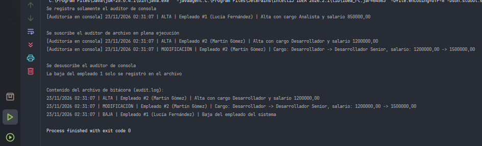

# Ejercicio 03 - Registro Automático de Auditoría por Consola

## Descripción

Un sistema de gestión empresarial debe informar automáticamente cada operación crítica sobre los empleados (alta, baja y modificación) a un módulo de auditoría por consola y a una bitácora en archivo, sin acoplar la lógica de negocio a esos módulos.

## Objetivos

- Canalizar eventos de negocio hacia varios receptores independientes.
- Mantener la lógica de negocio libre de llamadas a consola y a archivos.
- Permitir suscribir y desuscribir auditores mientras el programa se ejecuta.

## Implementación del patrón Observer

Se usa la variante de eventos: el sujeto construye un `AuditEvent` y lo envía a los observadores.

- **Sujeto:** `EmployeeRegistry` administra los empleados y dispara un evento en cada alta, modificación o baja.
- **Observador:** `AuditObserver` declara `onAuditEvent(AuditEvent event)`.
- **Observadores concretos:** `ConsoleAuditor` imprime el evento y `FileAuditor` lo agrega al archivo `audit.log`.
- **Suscripción dinámica:** `addAuditor` y `removeAuditor` se pueden llamar en cualquier momento.

## Propósito de la clase

- `AuditAction`: tipo de operación (alta, modificación, baja).
- `AuditEvent`: evento inmutable con los datos de la operación.
- `AuditObserver`: interfaz común de los auditores.
- `Employee`: datos del empleado, sin ninguna dependencia de consola ni archivos.
- `EmployeeRegistry`: sujeto observable y registro central.
- `ConsoleAuditor`: auditor que escribe por consola.
- `FileAuditor`: auditor que escribe en la bitácora.
- `Main`: agrega y quita auditores durante la ejecución y muestra el contenido de la bitácora.

## Concepto clave

La lógica de negocio solo emite eventos; qué se hace con ellos lo deciden los observadores. Se pueden sumar auditores nuevos sin tocar `EmployeeRegistry` ni `Employee`.

## Resultado

## Conclusión

El patrón Observer permite que una misma operación llegue de forma ordenada a varios destinos independientes. La auditoría queda separada del negocio y puede activarse o desactivarse en tiempo de ejecución, lo que reduce el acoplamiento y facilita el mantenimiento.
